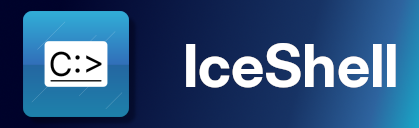

<!-- If you forgot the ID it may not render correctly -->

<!--suppress HtmlDeprecatedAttribute -->

<h1>IceShell</h1>

A cross-platform shell interpreter written in C#, and is inspired by Windows Command Prompt and
MS-DOS `command.com`.

## Usage

See the [IceShell Reference](docs/manual/README.md). Alternatively, type `help` in the IceShell.

## Installation

### Release builds

Before you download a release build, please do note that this project is in rapid development stage. This means the source code in the repository is much more newer than the release versions.

Releases can be found at the release page. See [release change-logs](CHANGELOG.md).

### Development builds

Development builds are not currently available.

### Build from Source

See [BUILDING](BUILDING.md) file.

## Contributing

This project welcomes contributions! See the [Contributing Guide](CONTRIBUTING.md) for more information.

## Thanks

- Thanks [JetBrains](https://jetbrains.com/) for providing a free licence of their tools for the development of the IceShell project. Their .NET tools like Rider IDE have really helped me develop this project, and I really appreciate that.

## License

[GPL-3.0-or-later](COPYING.txt)
