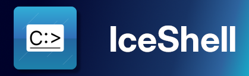

<!-- If you forgot the ID it may not render correctly -->

<!--suppress HtmlDeprecatedAttribute -->

<h1>IceShell</h1>

[English](../README.md) | **中文**

一个用 C# 编写的，启发于 Windows 命令提示符和 MS-DOS `command.com` 的跨平台命令解释器

## 使用说明

详见 [IceShell 参考说明书（英文）](docs/manual/README.md)。 您也可以在程序内输入 `HELP` 来取得命令的帮助。

## 下载和安装

### 发布版

请注意：由于本项目正在快速开发中，因此发布版会与目前存储库内的源代码中的版本有很大延迟。

您可以在“版本发布”页面中找到发布版下载。另见[更新日志（英文）](CHANGELOG.md)。

### 开发版

目前没有开发版。

### 从源码编译

请见[编译指南（英文）](../BUILDING.md)文件。

## 贡献

本项目欢迎任何形式的帮助！详情请见[贡献者指南（英文）](../CONTRIBUTING.md)。

## 鸣谢

- 特别感谢 [JetBrains](https://jetbrains.com/) 公司为本开源项目提供一份开源项目使用其产品开发的许可！

## 许可证

[GPL-3.0-or-later](COPYING.txt)
